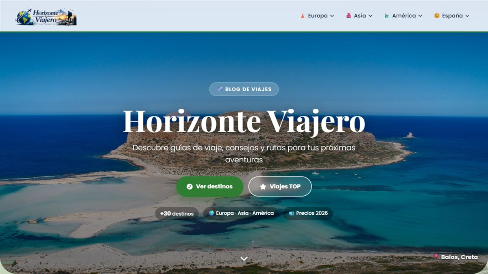
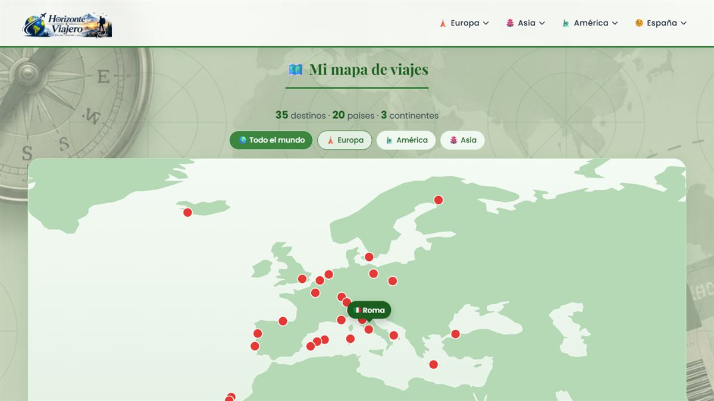
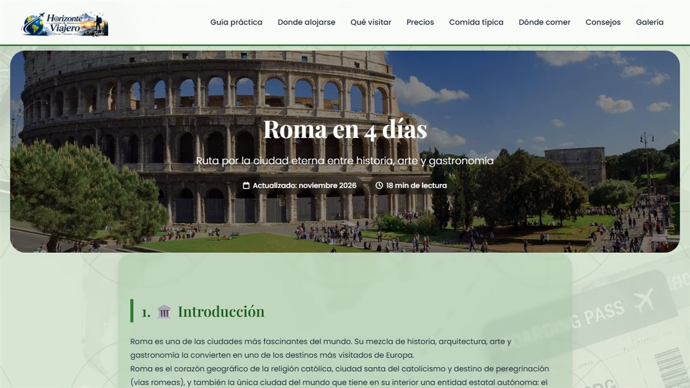
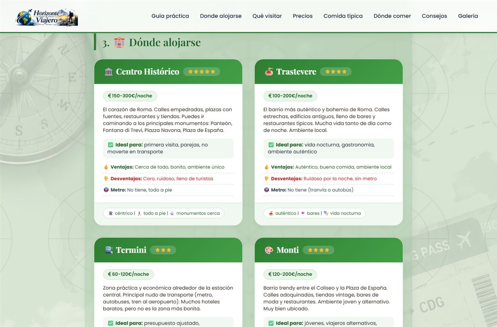
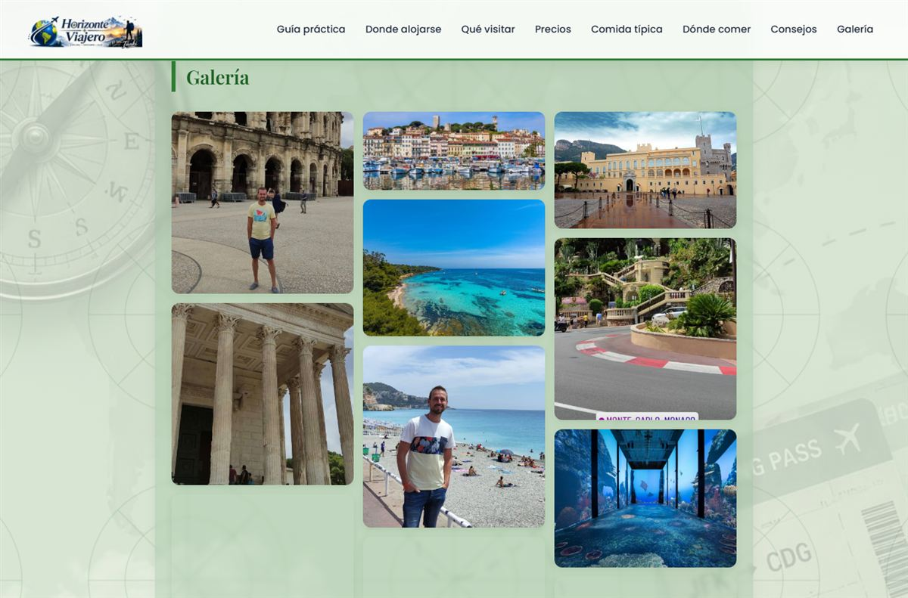
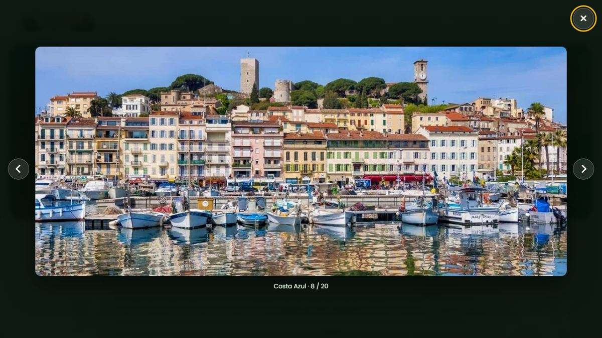
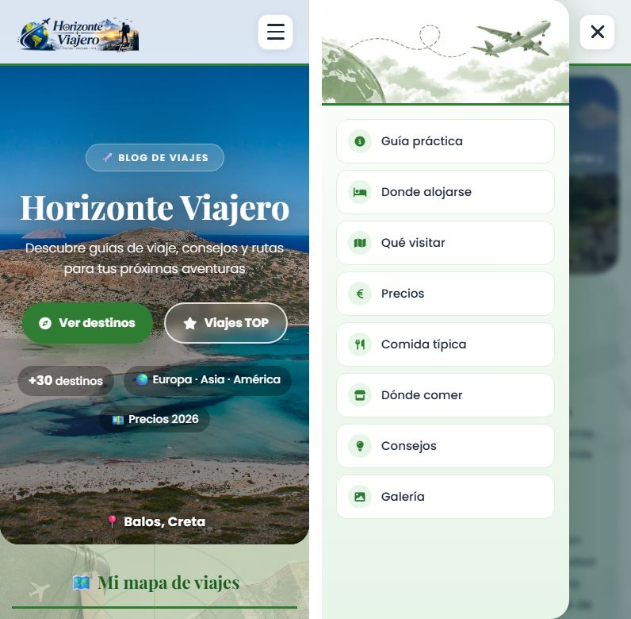

<div align="center">
  
  
  
  
  
</div>
<br>

# 🌍 Horizonte Viajero

Blog personal de viajes donde comparto mis rutas, consejos y experiencias por el mundo. Cada destino tiene su propia guía con qué ver, dónde dormir, qué comer, cuánto cuesta y una galería con mis fotos.

> **Web:** [https://horizonte-viajero.com](https://horizonte-viajero.com)

<br>

## ✨ Características

### Contenido
- 🗺️ **35 guías de viaje** en 20 países de Europa, Asia y América, más rutas por España.
- 📋 **Guías completas**: información práctica, dónde alojarse, qué ver, precios, qué comer, dónde comer, consejos, mapa de la ruta y galería.
- 📅 **Fecha de actualización y tiempo de lectura** en la cabecera de cada guía.
- 🔗 **"Otras guías que te pueden interesar"** al final de cada destino, elegidas por afinidad (país, continente y tipo de viaje).

### Portada
- 🖼️ **Pase de fotos** de varios destinos con fundido y zoom suave.
- 🌐 **Mapa del mundo interactivo** con un punto por destino, enlazado a su guía, y zoom a Europa, América y Asia.
- 🧭 Secciones de **últimos viajes, viajes TOP, fin de semana y verano**.

### Experiencia
- 📱 **Diseño responsive** con menú lateral en el móvil.
- 🔍 **Visor de fotos propio** en las galerías: flechas, teclado (← → Esc) y deslizar con el dedo.
- 🎬 **Vídeos** con portada que no se descargan hasta darle al play.
- ♿ **Accesibilidad**: textos alternativos en todas las imágenes, foco visible y respeto a "reducir movimiento".

### Rendimiento y SEO
- ⚡ Imágenes con **carga diferida** (`loading="lazy"`) y **comprimidas**.
- 🚫 **Sin jQuery ni librerías pesadas**: todo el JavaScript es propio.
- 🔎 **Descripción, Open Graph y datos estructurados** (schema.org) en cada página, con **sitemap.xml** y **robots.txt**.
- 🖼️ **Vista previa al compartir** en WhatsApp y redes con la foto de cada guía.

### Privacidad
- 🍪 **Aviso de cookies**: la web no usa cookies propias y los mapas de Google Maps no se cargan hasta que el visitante lo acepta.
- ⚖️ **Aviso legal, política de privacidad y política de cookies.**

<br>

## 📸 Capturas

<div align="center">

| Portada | Mapa de viajes |
|:---:|:---:|
|  |  |

| Cabecera de una guía | Dónde alojarse |
|:---:|:---:|
|  |  |

| Galería en mosaico | Visor de fotos |
|:---:|:---:|
|  |  |

| Móvil: portada y menú |
|:---:|
|  |

</div>

<br>

## 🛠️ Tecnologías

| Tecnología | Uso |
|------------|-----|
| HTML5 | Estructura de las páginas |
| CSS3 (Flexbox, Grid, columnas) | Diseño, animaciones y responsive |
| JavaScript (sin frameworks) | Menú, mapa, visor de fotos, aviso de cookies |
| [Font Awesome 6](https://fontawesome.com/) | Iconos |
| [Google Fonts](https://fonts.google.com/) | Tipografías Playfair Display y Poppins |
| [Twemoji Country Flags](https://github.com/talkjs/country-flag-emoji-polyfill) | Banderas de países en Windows |
| [Natural Earth](https://www.naturalearthdata.com/) | Contornos del mapa del mundo (dominio público) |
| Cloudflare Pages | Alojamiento y publicación automática |

<br>

## 📁 Estructura del proyecto

```text
horizonte-viajero/
│
├── 📄 index.html                 # Portada: pase de fotos, mapa y secciones de destinos
├── 📄 roma.html, japon.html…     # 35 guías de destino (una página por destino)
├── 📄 aviso-legal.html           # Aviso legal
├── 📄 privacidad.html            # Política de privacidad
├── 📄 cookies.html               # Política de cookies
├── 📄 404.html                   # Página de error (rutas absolutas)
│
├── 📄 sitemap.xml                # Mapa del sitio para los buscadores
├── 📄 robots.txt                 # Indicaciones para los buscadores
├── 📄 _redirects                 # Redirecciones de Cloudflare Pages
├── 📄 favicon.ico                # Icono de la web
│
├── 📁 css/
│   ├── inicio.css                # Estilos de la portada
│   ├── ciudades1.css             # Estilos de las guías
│   ├── pie.css                   # Pie de página y aviso de cookies (todas las páginas)
│   └── logos1.css                # Tamaño del logo
│
├── 📁 js/
│   ├── index.js                  # Portada: menú, pase de fotos y mapa
│   ├── ciudades1.js              # Guías: menú y sección activa
│   ├── visor.js                  # Visor de fotos de las galerías
│   └── cookies.js                # Aviso de cookies y carga de los mapas
│
├── 📁 img/
│   ├── roma/, japon/…            # Fotos de cada destino
│   ├── og/                       # Fotos para la vista previa al compartir (1200×630)
│   └── videos/                   # Portadas de los vídeos
│
└── 📁 docs/capturas/             # Capturas de este README
```

<br>

## ➕ Cómo añadir un destino nuevo

1. Crea la página copiando una guía parecida (por ejemplo `roma.html`) y cambia el contenido.
2. Guarda las fotos en `img/<destino>/` con nombres sin espacios ni "ñ" (`destino1.jpg`, `destino2.jpg`…).
3. Añade su tarjeta en `index.html`, en la sección que corresponda, y su enlace en el menú.
4. Añade su punto en el mapa del mundo de la portada (necesita latitud y longitud).
5. Crea su foto de vista previa en `img/og/<destino>.jpg` (1200×630).
6. Añade la página a `sitemap.xml`.
7. Añade su bloque de "Otras guías" y revisa los de los destinos relacionados.

<br>

## 💻 Probar en local

```bash
# 1. Clonar el repositorio
git clone https://github.com/ignaciozagea/horizonte-viajero.git
cd horizonte-viajero

# 2. Servirlo con un servidor local, por ejemplo:
#    - XAMPP: copiar la carpeta en htdocs y abrir http://localhost/horizonte-viajero/
#    - Python: python -m http.server 8000  →  http://localhost:8000
```

> La página `404.html` usa rutas absolutas (`/css/…`) para funcionar en cualquier dirección de Cloudflare Pages, así que en XAMPP se ve sin estilos.

<br>

## 🚀 Publicación

La web se publica automáticamente en **Cloudflare Pages** con cada cambio en la rama `main`. Cada mejora se hace en su propia rama `feature/…` y se integra en `main` mediante una *pull request*.

<br>

## 👤 Autor

**Iñaki Zamora Gea**

- GitHub: [@ignaciozagea](https://github.com/ignaciozagea)
- Instagram: [@inyaki_zagea](https://www.instagram.com/inyaki_zagea/)
- Web: [horizonte-viajero.com](https://horizonte-viajero.com)

<br>

## 📄 Derechos

© 2026 Horizonte Viajero · Iñaki Zamora Gea. Todos los textos y fotografías propias son del autor; no está permitido reproducirlos sin permiso. Los contornos del mapa proceden de Natural Earth (dominio público).
